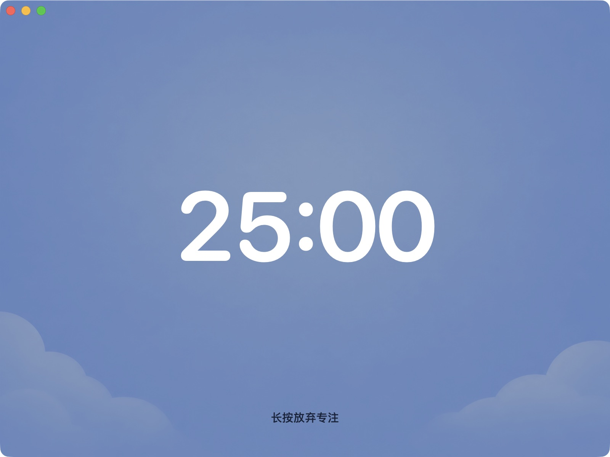
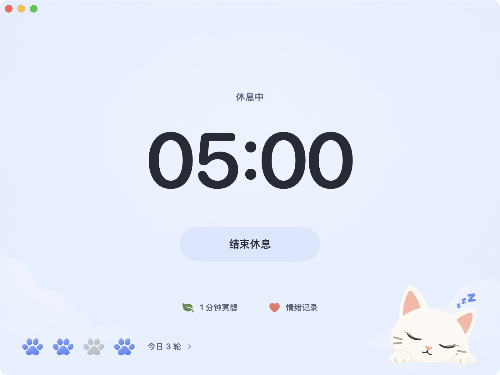
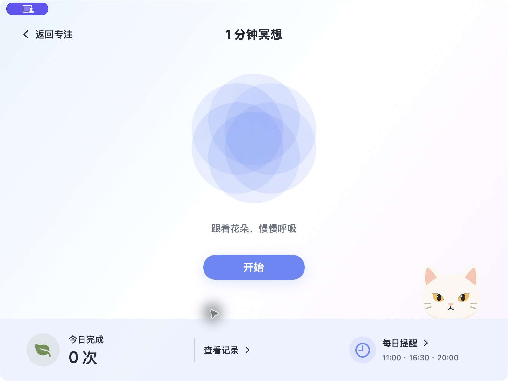
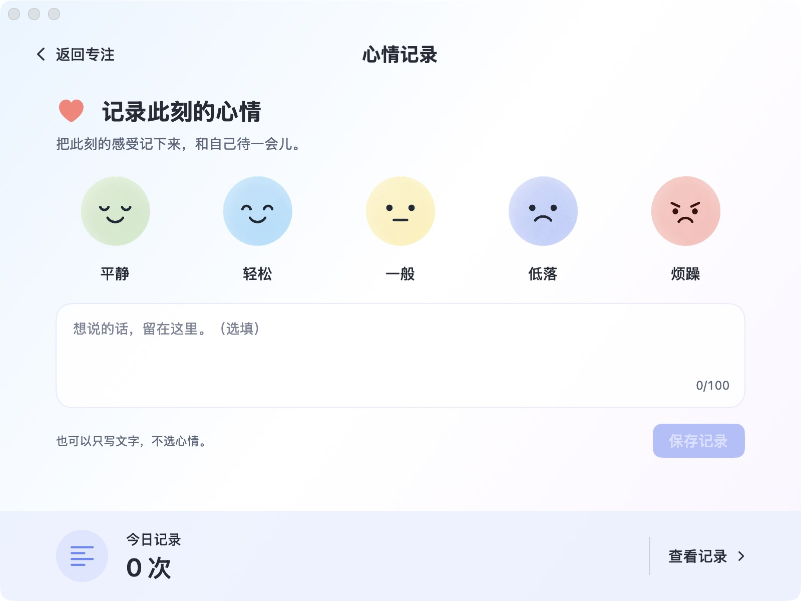
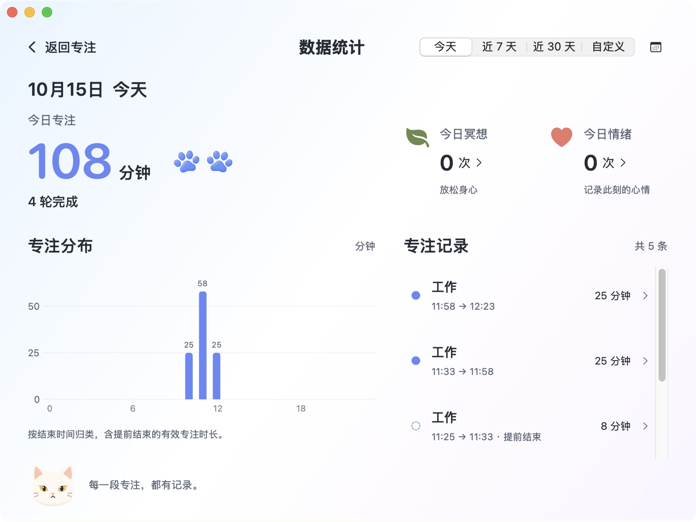

# v1.1.2 界面预览

以下图片来自独立原生预览，仅使用示例记录。运行中的专注不显示设置、重置或其他工具；休息由用户手动结束，不会自动开始下一轮。

## 准备

## 专注中

## 完成与休息

## 冥想与提醒

## 心情记录

## 数据统计

实际应用配图和图标源文件位于 ../Resources/ 和 ../Assets.xcassets/。不包含用户截图、个人记录、偏好文件或临时诊断材料。
